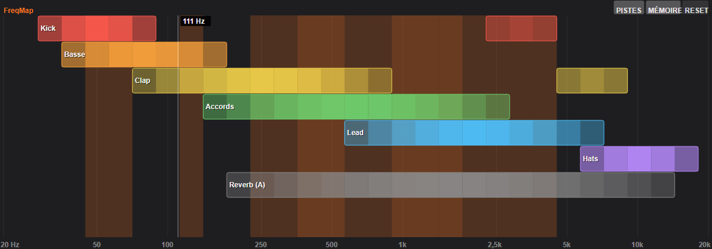

# Ableton Simon Plugs

Devices Max for Live pour Ableton Live 12 (Max 9). Un dossier par plugin dans [`plugins/`](plugins).

## Plugins

### [FreqMap](plugins/freqmap/README.md)
Où vit chaque son : une ligne par piste sur l'axe 20 Hz – 20 kHz, zones de masquage entre pistes en orange, mode guide avec les zones de référence (Sub, Kick, Basse, « Boue »…).

## Installation
Copier le dossier `dist/` d'un plugin **avec ses `.js`** dans la User Library de Live (`Presets/Audio Effects/Max Audio Effect/<Nom>/`), puis glisser le device sur une piste.
