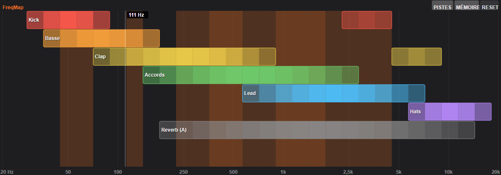
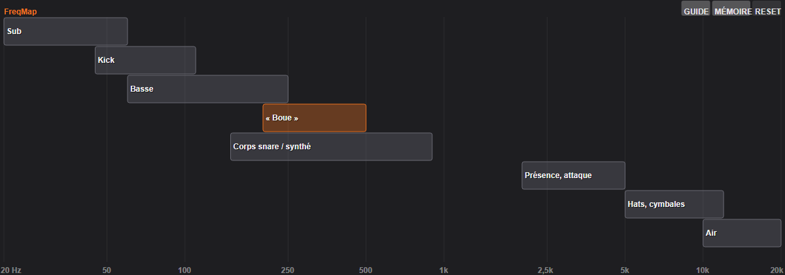

# FreqMap

Carte « où vit chaque son » : quelle piste occupe quelle zone du spectre, sur un seul visuel.

*Mode PISTES, fenêtre agrandie. Rendu du code d'affichage avec des données de démonstration (`tools/render_view.js`), pas une capture de Live.*

*Mode GUIDE : zones de référence à garder en tête pendant tout le mixage.*

- **FreqMap Probe** — à poser sur chaque piste. Analyse en 30 bandes de 1/3 d'octave (25 Hz – 20 kHz), récupère nom et couleur de la piste via la Live API.
- **FreqMap** — un seul, sur le Master. Une ligne par piste, axe log 20 Hz – 20 kHz ; une piste peut avoir plusieurs zones (ex. kick : sub + clic). Orange = au moins deux pistes fortes sur la même bande (masquage probable). Survol = fréquence + pistes en conflit. Modes PISTES / GUIDE, MÉMOIRE, RESET, AGRANDIR.

## Installation
Copier `dist/*.amxd` **et** les deux `.js` dans un même dossier de la User Library (ex. `Presets/Audio Effects/Max Audio Effect/FreqMap/`).

## Rebuild
`python3 build.py` → `dist/`

## Limites
Mesure en crête par bande, pas en sonie perçue. Device non gelé (Freeze dans Max pour le distribuer en un seul fichier).
