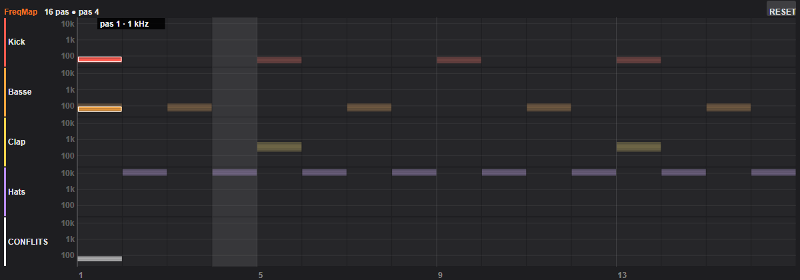

# FreqMap

Grille 16 pas par piste : quelle fréquence sonne à quel pas, et où les pistes se marchent dessus.

*Simulation d'un pattern d'une mesure à 125 BPM (`tools/render_view.js`), pas une capture de Live. Seul conflit : kick + basse au pas 1.*

## Les deux devices
- **FreqMap Probe** : à poser en fin de chaîne sur chaque piste. Analyse en 30 bandes de 1/3 d'octave (25 Hz – 20 kHz) toutes les 20 ms ; récupère nom et couleur de la piste via la Live API (même dans un rack).
- **FreqMap** : un seul, sur le Master. Affiche la grille.

## Lecture de la grille
- Une ligne par piste, une colonne par pas de 1/16 sur une mesure (16 pas en 4/4).
- Dans chaque case : le spectre de la piste à ce pas, grave en bas, repères 100 Hz / 1k / 10k.
- **Conflit** = au moins deux pistes fortes (à moins de 9 dB de leur propre pic) sur la même bande au même pas. Ces zones restent en couleur pleine et sont cerclées de blanc ; le reste est atténué.
- **Ligne CONFLITS** (en bas) : uniquement les bandes en conflit, par pas ; plus blanc = 3 pistes ou plus.
- Survol : pas, fréquence, pistes concernées.
- Les pas déjà joués de la mesure en cours sont à jour ; les suivants montrent la mesure précédente.
- **RESET** vide la grille. **AGRANDIR** ouvre la vue en 1200 × 620.

## Installation
Copier `dist/*.amxd` **et** les deux `.js` dans un même dossier de la User Library (ex. `Presets/Audio Effects/Max Audio Effect/FreqMap/`).

## Rebuild
`python3 build.py` → `dist/`

## Limites
- Mesure en crête par bande, pas en sonie perçue.
- Calage temps : la vue compense un retard estimé de 40 ms (`LAT_MS` dans `freqmap_view.js`). Si tout apparaît décalé d'un pas, c'est ce réglage.
- Device non gelé (Freeze dans Max pour le distribuer en un seul fichier).
